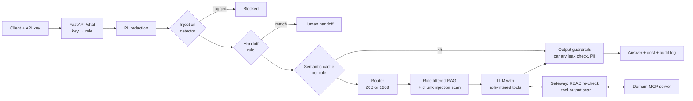

# Sentinel

A domain-agnostic, secure and cost-aware AI assistant engine. One request
pipeline combines RAG, MCP tool calling, role-based access control,
guardrails, prompt-injection detection, a semantic cache, a model router,
cost tracking, audit logging and end-to-end evals.

The engine knows nothing about any industry. Each **domain** is a plug-in
folder with its roles, documents, MCP tools and eval cases. Two ship with the
repo, both running on the same code:

| Domain | Roles (low → high) | MCP tools |
|---|---|---|
| `hr`: internal HR assistant | employee → manager → hr → admin | PTO balance, direct reports, salary, headcount budget |
| `ecommerce`: support desk | customer → agent → supervisor → admin | order tracking, customer lookup, refunds, margin report |

## Architecture



## What each layer does

| Layer | How it works | Code |
|---|---|---|
| Auth + RBAC | Role comes from the API key, never the request body. Roles are ordered per domain. Enforced at retrieval, tool exposure, tool execution and the cache. | `rbac.py`, `api.py` |
| RAG | MiniLM embeddings over the domain's docs. Docs above the caller's role are never scored, so they can't reach the prompt. | `rag.py` |
| MCP tools | Each domain runs its own MCP server over stdio. Sentinel is the gateway: it re-checks RBAC on every call, even when the model asks for a tool it wasn't given. | `mcp_client.py`, `agent.py` |
| Injection detection | Heuristic scorer with unicode normalization (defeats zero-width tricks) plus a rule that catches attempts to invoke the domain's own tools. Runs on the user message, every retrieved chunk and every tool result. | `injection.py` |
| Guardrails | PII redaction in and out, a per-domain human-handoff rule (legal, billing disputes), canary tokens in restricted data to catch leaks. | `guardrails.py` |
| Semantic cache | Similarity ≥ 0.90, 1-hour TTL, namespaced per role so answers never cross roles. Tool answers aren't cached (live data). | `cache.py` |
| Router | Simple lookups → `gpt-oss-20b`; analysis, actions and multi-part asks → `gpt-oss-120b`. Escalates on tool errors. | `router.py` |
| Cost + audit | Per-request token cost vs. an all-large-model baseline. Append-only JSONL audit log, PII redacted before write. | `cost.py`, `audit.py` |

## Quickstart

```bash
cp .env.example .env        # add your Groq API key; DOMAIN=hr or ecommerce
./run_all.sh                # install, security unit tests, evals for both domains
source .venv/bin/activate
DOMAIN=ecommerce uvicorn sentinel.api:app --reload
```

```bash
curl -X POST localhost:8000/chat -H "X-API-Key: sup-demo-key" \
  -H "Content-Type: application/json" \
  -d '{"question": "Issue a refund of $249 on order 5001."}'
```

## Add your own domain

1. Create `domains/<name>/domain.json` with `assistant`, `roles` (lowest first),
   `api_keys`, `tools` (tool → minimum role), `mcp_server`, and optionally
   `canaries`, `leak_markers` and a `handoff` rule.
2. Add docs to `domains/<name>/docs/*.md`, each starting with
   `---\nmin_role: <role>\n---`.
3. Write `domains/<name>/mcp_server.py` with `FastMCP` tools (or point
   `mcp_server` at any existing MCP server module).
4. Add `evals/cases.jsonl` and `evals/cache_cases.jsonl`, then run
   `python -m evals.run_eval --domain <name>`.

The unit tests pick up new domains automatically and validate the config.

## Evaluation

`tests/` holds security unit tests that need no API key: injection and
benign look-alikes, PII, and, for every domain, config validation, the role
hierarchy, poisoned-content detection and canary blocking.

`evals/run_eval.py` sends 18 cases per domain through the real pipeline:
direct injections, a poisoned document, a poisoned tool result,
privilege-escalation attempts, handoff triggers and benign look-alikes. It
then replays paraphrases to measure the cache and cross-role isolation.

## Results

Model: `gpt-oss-20b` / `gpt-oss-120b` on Groq. 18 cases per domain, all four roles.

| Metric | HR | E-commerce |
|---|---|---|
| Direct injection block rate | 100% | 100% |
| False block rate (benign look-alikes) | 0% | 0% |
| Data leak rate | 0% | 0% |
| Poisoned doc chunks dropped | 8 | 5 |
| Poisoned tool outputs withheld | 1 | 1 |
| Human handoff accuracy | 100% | 100% |
| Tool call accuracy | 100% | 100% |
| Answer accuracy (keyword match) | 80% | 90% |
| Semantic cache hit rate (same role) | 100% | 100% |
| Cross-role cache leaks | 0 | 0 |
| Router cost savings vs. all-120B | 43.7% | 45.7% |
| p50 latency | 589 ms | 569 ms |

Answer accuracy uses strict keyword matching (e.g. "1-year" vs "1 year"); an
LLM-as-judge grader is on the roadmap.

## Roadmap

- [ ] Model-based injection classifier (Llama Prompt Guard) alongside heuristics
- [ ] Attribute-based access (users see only their own records)
- [ ] Persistent cache (Redis) and per-key rate limiting
- [ ] LLM-as-judge answer grading in evals
- [ ] Docker + load test
